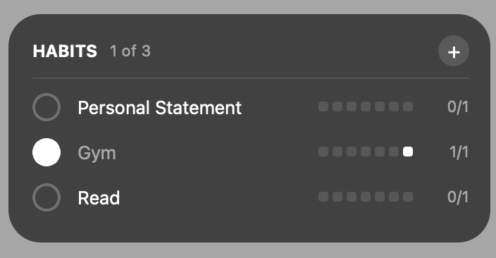
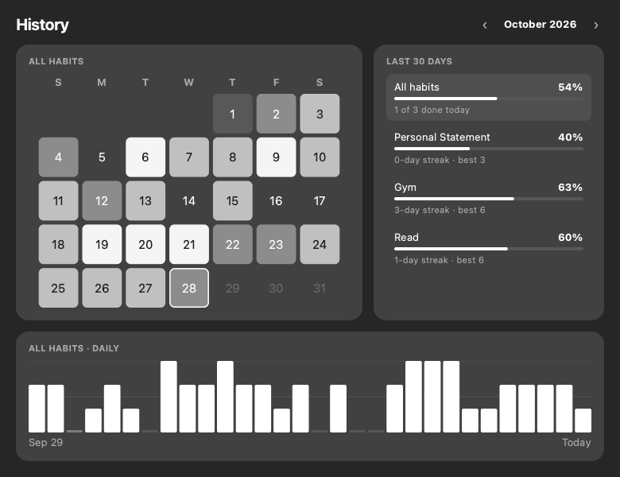

# Advent of Habit

A minimal habit tracker that lives on your macOS desktop and looks like a native widget, without needing Xcode.

<p>
  
</p>

Click the widget to open your history:



> Fork of [Alestainer/advent-of-habit](https://github.com/Alestainer/advent-of-habit), restyled as a desktop widget with unlimited habits and a history view.

## Features

- 🖥️ **Desktop widget.** Sits on the desktop behind your windows, on every Space, sized and colored to match the native macOS widgets (medium, or large once you have more than 3 habits)
- ➕ **Any number of habits.** Add with **+**, remove by right-clicking a habit
- ⚪ **Tick off today.** Each habit shows a 7-day dot strip and how many of the last 21 days you did it
- 📅 **History.** Click the widget for a month calendar shaded by how much you got done, 30-day completion rate and streaks per habit, and a daily bar chart. Click a habit to filter.
- ⏰ **Check-in reminder.** During your chosen window (morning 6–11 AM or evening 6–11 PM), if you haven't logged anything yet, the widget floats above your windows until you tick something or click **hide**
- ✓ **Menu bar icon** with Show History, Add Habit, Allow Moving Widget, and Quit
- 🌙 Rolls over to a new day at midnight, and saves everything locally

## Download

Grab **Advent-of-Habit-macOS-arm64.zip** from the [latest release](https://github.com/0909yejun0909-commits/advent-of-habit/releases/latest) (Apple Silicon). Unzip it, move the app to Applications, and open it. The app isn't notarized, so the first time macOS will block it. Go to **System Settings → Privacy & Security → Open Anyway**.

## Build from source

Requires macOS 10.15+ and Python 3.9+.

```bash
git clone https://github.com/0909yejun0909-commits/advent-of-habit.git
cd advent-of-habit
python3 -m venv venv
source venv/bin/activate
pip install -r requirements.txt
./build_macos_app.sh
cp -R "dist/Advent of Habit.app" /Applications/
open "/Applications/Advent of Habit.app"
```

To run without building, use `python launch_habit_tracker.py`.

To start it automatically, add it in **System Settings → General → Login Items**.

## Usage

1. On first launch, enter your habits and pick a reminder time
2. Drag the widget where you want it (e.g. lined up under your other widgets), then uncheck **Allow Moving Widget** in the menu bar menu to lock it
3. Tick habits as you do them. Click anywhere else on the widget to see your history

## Data

Everything is stored locally, nothing leaves your Mac:

```
~/Library/Application Support/Advent of Habit/
├── config.json       # habits, reminder time, widget position
└── habit_data.json   # {"YYYY-MM-DD": {"habit": true/false}}
```

To reset, quit the app and delete that folder.

## License

MIT, see [LICENSE](LICENSE).
